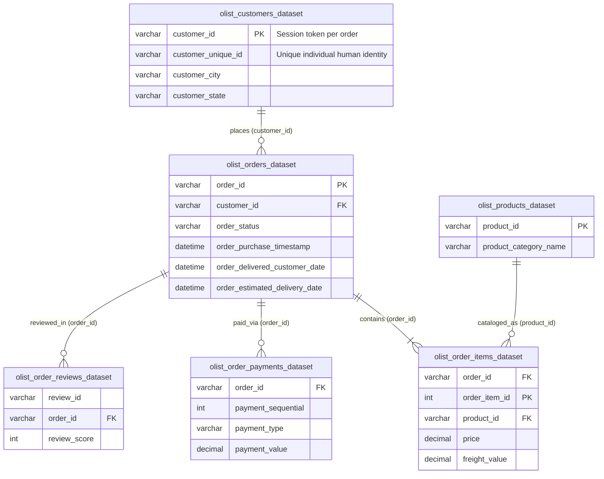

# E-Commerce Operations & Supply Chain Performance (SQL Analysis)

[](https://www.microsoft.com/en-us/sql-server/)
[](https://learn.microsoft.com/en-us/sql/ssms/)
[](https://opensource.org/licenses/MIT)

**Lead Analyst:** Ashika Raj  
**Dataset:** Brazilian E-Commerce Public Dataset by Olist (100k+ real marketplace transactions, 2016–2018)  
**Full Report:** [Executive Summary (`reports/EXECUTIVE_SUMMARY.md`)](reports/EXECUTIVE_SUMMARY.md)

---

## 📌 Executive Summary

This project conducts an end-to-end SQL operational and commercial audit of **Olist**, Brazil's largest e-commerce department store marketplace. Querying over 100,000 relational records across 8 tables, the analysis evaluates platform health across **R$13.22M in delivered product revenue (GMV)** and **96,478 delivered orders**.

The investigation revealed three critical operational realities:
1. **The Retention Cliff:** Only **3.20% of delivered orders** originate from returning buyers (93,358 first orders vs. 3,120 repeat orders), leaving the business exposed to high acquisition costs with near-zero lifetime value compounding.
2. **Growth Plateau:** Following an all-time peak during Black Friday 2017 (**R$987.8K, +52.37% MoM**), monthly revenue momentum decelerated through mid-2018, with the 3-month rolling average sliding from **R$968K to R$854K**.
3. **Delivery SLA Impact:** While 91.89% of orders arrive early due to heavily padded estimates (avg. 13.7 days buffer), **late deliveries cut customer review scores by 47.1% (from 4.29 ⭐ down to 2.27 💔)**, with **Rio de Janeiro** generating 1,495 delayed orders and northeastern states (AL, MA, SE) exceeding a 15–21% breach rate.

---

## 🗄️ Relational Database Schema

The analysis connects 6 core tables across customer, order, fulfillment, financial, and satisfaction dimensions:



---

## 🛠️ Tech Stack & Advanced SQL Techniques

* **Engine / Dialect:** Microsoft SQL Server (T-SQL) queried via SQL Server Management Studio (SSMS).
* **Common Table Expressions (CTEs):** Multi-stage modular pipelines and Cartesian fan-out prevention.
* **Window Functions:**
  * `ROW_NUMBER() OVER (PARTITION BY customer_unique_id ORDER BY order_purchase_timestamp)` — Customer purchase sequencing (first-time vs. repeat buyers).
  * `DENSE_RANK() OVER (PARTITION BY customer_state ORDER BY total_spend DESC)` — Top VIP customers per Brazilian state without skipping ranks on ties.
  * `LAG(monthly_revenue, 1) OVER (ORDER BY order_year, order_month)` — Month-over-Month (MoM) revenue growth velocity.
  * `AVG() OVER (ORDER BY ... ROWS BETWEEN 2 PRECEDING AND CURRENT ROW)` — 3-month rolling averages for trend smoothing.
* **Date Arithmetic & Integrity:** `DATEDIFF(day, ...)` for SLA breach calculation, `LEFT JOIN ... IS NULL` for orphan record auditing, and composite primary key grain verification.

---

## 📊 Key Findings Scorecard

| Analysis Domain | Primary Metric | Result | Analytical & Business Takeaway |
| :--- | :--- | :---: | :--- |
| **Data Integrity** | Delivered Fulfillment Rate | **97.02%** | 96,478 fulfilled out of 99,441 placed orders. Zero orphan foreign keys. |
| **Sales Scorecard** | Gross Product Revenue (GMV) | **R$13.22M** | Delivered order item sales excluding freight across 96,478 orders. |
| **Unit Economics** | Average Order Value (AOV) | **R$137.04** | Mean basket size of **1.14 items/order** confirms single-item basket dominance. |
| **Top Category** | Highest Revenue Category | **Beleza Saúde** | Health & Beauty generated **R$1.23M** (9,465 items), followed by Watches (**R$1.17M**). |
| **Customer Retention** | Repeat Purchase Order Share | **3.20%** | Only 3,120 repeat orders out of 96,478; 96.8% of orders are one-and-done purchases. |
| **Growth Velocity** | Black Friday Spike vs Plateau | **+52.37% MoM** | Peaked in Nov 2017 (R$987.8K); rolling run-rate contracted from R$968K to R$854K in mid-2018. |
| **Delivery Timeliness** | Early Delivery vs SLA Breach | **91.89% Early** | 88,644 orders arrived early (avg -13.7 days buffer); **6.77% (6,534 orders)** breached SLA. |
| **Customer Satisfaction** | Review Score Penalty for Delays | **-47.1% Drop** | Early deliveries average **4.29 ⭐**; late deliveries collapse to **2.27 💔** (avg +10.5 days late). |

---

## 💡 Strategic Recommendations

1. **Immediate Carrier Remediation (0–30 Days):**
   * Target **Rio de Janeiro (RJ)** which produces **1,495 delayed orders** (12.11% breach rate), alongside northeastern routes (**Alagoas: 21.41%**, **Maranhão: 17.43%**, **Sergipe: 15.22%**).
   * Restructure 3PL carrier contracts to enforce service standards for shipments exceeding promised dates by >5 days.
2. **Customer Retention & Lifecycle Engine (30–90 Days):**
   * Address the **96.8% single-order dependency** by deploying automated post-purchase email workflows within 14 days of delivery.
   * Incentivize second orders with complementary category promotions; doubling retention from 3.2% to 6.4% unlocks **R$420K+ in zero-CAC revenue**.
3. **Dynamic Route-Based Delivery Promises (90–180 Days):**
   * Recalibrate delivery estimates by replacing blanket national buffers with route-specific historical ETAs.
   * Compressing the artificial 13.7-day early buffer in low-risk urban centers (e.g., SP-SP) will boost checkout conversion against fast-shipping competitors without increasing breach liability.

---

## 📂 Repository Structure & SQL Pipeline

```
ecommerce-operations-sql-analysis/
├── sql/
│   ├── 01_data_integrity_checks.sql        # Table grains, key uniqueness & orphan detection
│   ├── 02_sales_and_kpis.sql                # Macro KPIs, category economics & CTE fan-out fix
│   ├── 03_customer_lifetime_sequencing.sql  # ROW_NUMBER() sequencing & DENSE_RANK() state VIPs
│   ├── 04_mom_growth_and_trends.sql         # LAG() MoM velocity & 3-month rolling averages
│   └── 05_delivery_sla_bottlenecks.sql      # DATEDIFF SLA breach analysis & review correlations
├── reports/
│   └── EXECUTIVE_SUMMARY.md                 # Full commercial report & phased action roadmap
├── BRIEF.md                                 # Stakeholder business problem statement
├── README.md                                # Project overview & portfolio documentation
└── .gitignore                               # Environment & data file ignore rules
```

---

## 🚀 How to Reproduce

1. **Prerequisites:** Install [SQL Server Express / Developer](https://www.microsoft.com/en-us/sql-server/) and [SSMS](https://learn.microsoft.com/en-us/sql/ssms/).
2. **Dataset:** Download the Brazilian E-Commerce dataset from [Kaggle](https://www.kaggle.com/datasets/olistbr/brazilian-ecommerce).
3. **Import:** Import CSVs into a database named `olist_ecommerce` using the SSMS Flat File Import Wizard.
4. **Execution:** Execute the scripts inside [`sql/`](sql/) in numerical sequence:
   * Run [`sql/01_data_integrity_checks.sql`](sql/01_data_integrity_checks.sql) to audit schema integrity.
   * Run [`sql/02_sales_and_kpis.sql`](sql/02_sales_and_kpis.sql) to reproduce macroeconomic sales scorecards.
   * Run [`sql/03_customer_lifetime_sequencing.sql`](sql/03_customer_lifetime_sequencing.sql) for customer order sequencing.
   * Run [`sql/04_mom_growth_and_trends.sql`](sql/04_mom_growth_and_trends.sql) for MoM growth and rolling averages.
   * Run [`sql/05_delivery_sla_bottlenecks.sql`](sql/05_delivery_sla_bottlenecks.sql) for SLA breach and review score analysis.
